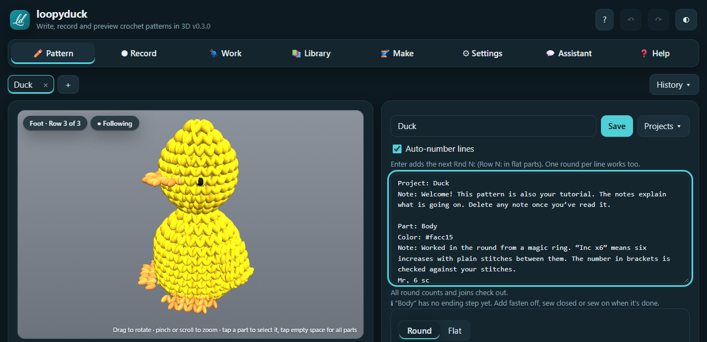

  

<h1 align="center">loopyduck</h1>

  <b>Write, check and preview crochet patterns in 3D.</b> 
  Made for amigurumi makers and small pattern designers.

  <a href="https://realboneduck.github.io/loopyduck-app/"><b>▶ Open loopyduck</b></a>

  

## What it does

- **Write patterns your way.** Type rounds and rows in ordinary wording, or tap them in on a keypad. loopyduck checks every stitch count and tells you when it can’t read a line instead of guessing.
- **See it in 3D**, stitch by stitch, with parts sewn together where you say. Replay the build with the slider.
- **Design a shape.** Pick a ball, disc, cylinder, cone or panel and a size, and it writes the rounds.
- **Crochet along.** The Work tab shows one round at a time with a big stitch counter and keeps your place.
- **Plan the make.** Yarn per colour, stuffing, seam lengths and the order to sew parts together.
- **Import** from pasted text, a PDF or a photo of a printed pattern, and check every line before it opens.
- **Charts, printing and share links.** Stitch symbol charts, a printable page (save it as a PDF) and links that carry the whole pattern.

## Install it

It works in any modern browser. Install it to get an app icon and offline use:

| Device | How |
| --- | --- |
| iPhone / iPad | Open the link in **Safari** ▸ Share ▸ **Add to Home Screen** |
| Android | Open the link in **Chrome** ▸ ⋮ menu ▸ **Install app** |
| Windows / Mac | Open the link in **Chrome** or **Edge** ▸ install icon in the address bar |

## Your patterns stay with you

Everything is saved in your browser on your own device. Nothing is uploaded, and there are no accounts. That also means patterns don’t move between devices by themselves: use **Settings ▸ Backup** to keep a copy or move to another device.

## Found a problem?

Send a backup file (**Settings ▸ Backup**) and a sentence about what you were doing. That shows exactly what you saw.

---

This repository only hosts the built app for the web link above. loopyduck by realboneduck (<a href="https://boneduck.com">boneduck.com</a>) is free software under the GNU AGPL v3 or later, with additional terms (see <a href="LICENSE">LICENSE</a> and <a href="NOTICE.md">NOTICE.md</a>). The version number is shown in the app’s header.
